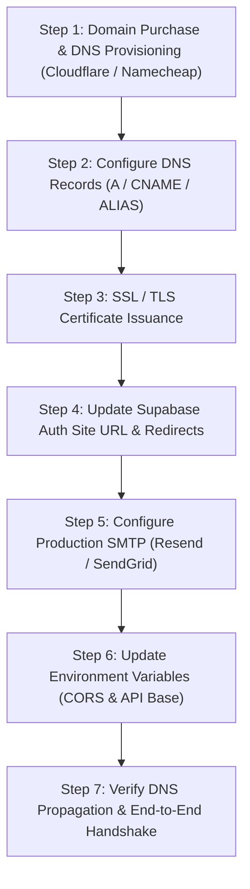

# QuestForge AI — Custom Domain Configuration & DNS Setup Guide

**Document Version:** 1.0.0  
**Phase:** 12 — Production Deployment Preparation & Final Security Audit  
**Date:** November 2026  
**Audience:** Site Administrator / DevOps Engineer  

---

## 1. Domain Planning & Architecture

QuestForge AI utilizes a decoupled web application architecture consisting of:
1. **Frontend Web App:** Static React SPA served via global Anycast Edge (e.g., Vercel / Cloudflare Pages).
2. **Backend API Service:** Express.js REST API with file processing buffers (e.g., Railway / Render).
3. **Auth & Database:** Supabase Cloud platform (`bwllksfjjxmumrrqaifa.supabase.co`).

### 1.1 Recommended Hostname Topology

Assuming a base custom domain of `questforge.ai`:

| Hostname | Type | Target Service | Purpose |
| :--- | :---: | :--- | :--- |
| `questforge.ai` (or `app.questforge.ai`) | Apex / Subdomain | Vercel / Cloudflare Pages | Main student portal, landing page, document upload & 3D canvas |
| `www.questforge.ai` | CNAME | Redirect to `questforge.ai` | User convenience redirect |
| `api.questforge.ai` | CNAME | Railway / Render backend | Secure REST API endpoint (`/api/*`), OCR processing, AI proxy |
| `auth.questforge.ai` | CNAME *(Optional)* | Supabase Custom Domain (Paid) | Custom auth endpoint (or default `*.supabase.co` on Free tier) |

---

## 2. Step-by-Step Configuration Workflow



### Step 1: DNS Provider Setup

We strongly recommend managing DNS via **Cloudflare** for:
- Free DDoS mitigation and Web Application Firewall (WAF).
- Universal SSL with automated certificate renewal.
- **CNAME Flattening** (allows CNAME at the root/apex domain `questforge.ai`).
- DNS response time <15ms globally.

---

### Step 2: Configure DNS Records

In your DNS Management console, configure the following records:

#### A. Frontend Records (Vercel Example)
| Type | Name / Host | Target / Content | Proxy Status | TTL |
| :--- | :--- | :--- | :--- | :--- |
| **A** | `@` (apex) | `76.76.21.21` | DNS Only (or Proxied) | Auto |
| **CNAME** | `www` | `cname.vercel-dns.com` | DNS Only (or Proxied) | Auto |
| **CNAME** | `app` *(optional)* | `cname.vercel-dns.com` | DNS Only (or Proxied) | Auto |

#### B. Backend API Records (Railway / Render Example)
| Type | Name / Host | Target / Content | Proxy Status | TTL |
| :--- | :--- | :--- | :--- | :--- |
| **CNAME** | `api` | `questforge-server.up.railway.app` (or Render URL) | DNS Only *(Recommended for streaming/websockets)* | Auto |

---

### Step 3: SSL / TLS Configuration

- **Minimum TLS Version:** TLS 1.3 (TLS 1.2 fallback allowed).
- **SSL Mode (if using Cloudflare):** **Full (Strict)** — ensures end-to-end encryption between visitor, Cloudflare Edge, and backend origins.
- **HSTS (HTTP Strict Transport Security):**
  - Enable HSTS with `max-age=31536000` (1 year), `includeSubDomains`, and `preload`.

---

### Step 4: Supabase Production Auth Configuration

When migrating from `localhost:5173` to your custom domain, update your Supabase Auth configuration in the Supabase Dashboard:

1. Open the [Supabase Dashboard](https://supabase.com/dashboard/project/bwllksfjjxmumrrqaifa).
2. Navigate to **Authentication &rarr; URL Configuration**.
3. **Site URL:** Set to `https://questforge.ai` (or `https://app.questforge.ai`).
4. **Redirect URLs:** Add the following authorized whitelist patterns:
   - `https://questforge.ai/**`
   - `https://questforge.ai/reset-password`
   - `https://questforge.ai/login`
   - `http://localhost:5173/**` *(Keep for local staging / testing)*

---

### Step 5: Custom SMTP Setup for Production Email Delivery

On the Supabase free tier, the default built-in SMTP has strict rate limits (typically 3–4 emails/hour), which causes `email rate limit exceeded` on production traffic. To ensure 100% reliable delivery for registration confirmation and password resets:

1. Create a free account at [Resend](https://resend.com) or [SendGrid](https://sendgrid.com).
2. Verify your custom domain (`questforge.ai`) in Resend (adds DKIM, SPF, and DMARC TXT records).
3. In Supabase Dashboard, go to **Project Settings &rarr; Authentication &rarr; SMTP Settings**:
   - **Enable Custom SMTP:** `ON`
   - **Sender Email:** `noreply@questforge.ai`
   - **Sender Name:** `QuestForge AI Support`
   - **Host:** `smtp.resend.com` (or SendGrid host)
   - **Port:** `465` (or `587`)
   - **Username:** `resend` (or `apikey`)
   - **Password:** `<YOUR_SMTP_API_KEY>`

---

### Step 6: Environment Variables Update for Custom Domain

#### Backend Environment Settings (`server`)
Update the backend environment in your hosting dashboard:
```ini
NODE_ENV=production
PORT=5000
CLIENT_URL=https://questforge.ai
```
*(The backend automatically accepts `CLIENT_URL` in its CORS whitelist).*

#### Frontend Environment Settings (`client`)
Update the frontend environment variables in Vercel:
```ini
VITE_API_URL=https://api.questforge.ai
VITE_SUPABASE_URL=https://bwllksfjjxmumrrqaifa.supabase.co
VITE_SUPABASE_ANON_KEY=<YOUR_PUBLIC_ANON_KEY>
```

---

### Step 7: Finalize SEO, Robots & Sitemap

Once your domain is registered:
1. Open `client/public/robots.txt` and verify:
   ```txt
   Sitemap: https://questforge.ai/sitemap.xml
   ```
2. Open `client/public/sitemap.xml` and replace all `<loc>` tags with your verified custom domain.
3. Re-run `npm run build` and deploy.

---

## 3. Pre-Launch Custom Domain Verification Checklist

Before announcing the site publicly, execute the following verification commands:

```bash
# 1. Verify DNS resolution for frontend
nslookup questforge.ai

# 2. Verify DNS resolution for API backend
nslookup api.questforge.ai

# 3. Test HTTPS SSL handshake & HTTP/2
curl -Iv https://questforge.ai

# 4. Test Backend Health Check through custom domain
curl -s https://api.questforge.ai/api/health | jq .

# 5. Verify CORS pre-flight response
curl -I -X OPTIONS https://api.questforge.ai/api/health \
  -H "Origin: https://questforge.ai" \
  -H "Access-Control-Request-Method: GET"

# 6. Test Password Recovery delivery to real test inbox
# (Must arrive within 10 seconds via custom SMTP)
```
