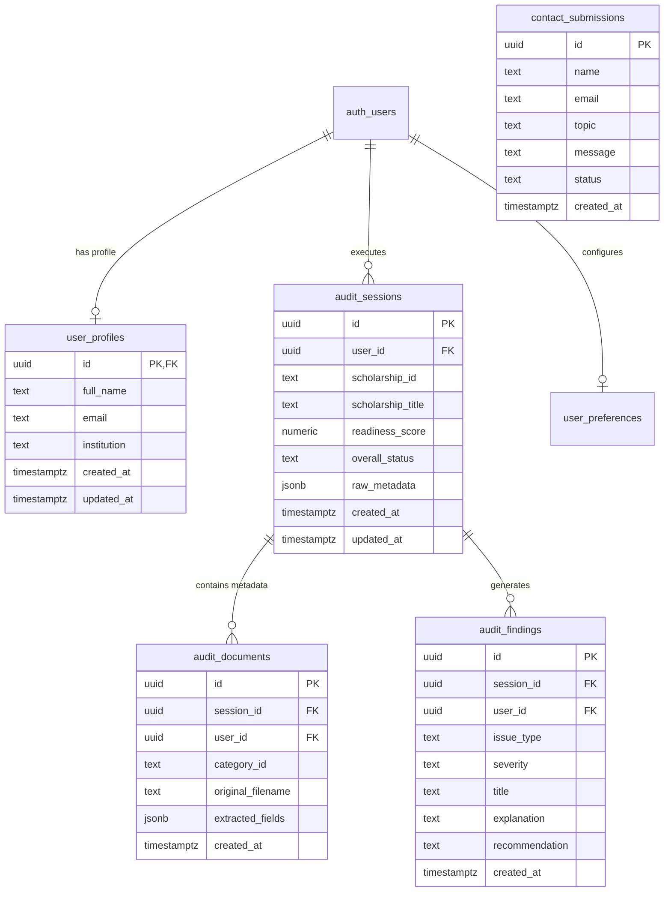

# QUESTFORGE AI — SUPABASE DATABASE ARCHITECTURE & SETUP GUIDE

**Document Version:** 1.0.0  
**Effective Date:** November 2026  
**Target Environment:** Supabase Cloud PostgreSQL 15+ / Self-Hosted Supabase  

---

## 1. ARCHITECTURAL OVERVIEW

QuestForge AI employs a hybrid persistence model:
1. **Unconfigured Environment (Demonstration Mode):** Operates on an isolated in-memory session repository. No data leaves the local process.
2. **Configured Environment (Cloud Persistence Mode):** Automatically synchronizes with Supabase Cloud PostgreSQL, enabling persistent user accounts, cross-device audit history, and multi-tenant Row-Level Security (RLS).

### Entity Relationship Diagram (ERD)



---

## 2. DATABASE MIGRATIONS

All migrations are located in `server/src/db/migrations/`:

| Migration File | Description | Execution Order |
|---|---|---|
| `001_initial_schema.sql` | Creates tables, extensions, foreign keys, constraints, indexes, and `updated_at` triggers | 1 |
| `002_row_level_security.sql` | Enables RLS on all tables, establishes user-scoped ownership policies, and configures new user auth trigger | 2 |

### Applying Migrations via Supabase Dashboard

1. Navigate to your Supabase project at [app.supabase.com](https://app.supabase.com/).
2. Open the **SQL Editor** tab from the left sidebar.
3. Click **New Query**.
4. Paste the entire contents of `server/src/db/migrations/001_initial_schema.sql` and click **Run**.
5. Paste the entire contents of `server/src/db/migrations/002_row_level_security.sql` and click **Run**.
6. Verify under **Table Editor** that the 6 tables appear with green shield icons indicating RLS enabled.

---

## 3. ROW-LEVEL SECURITY (RLS) POLICIES SUMMARY

| Table | Policy Name | Permitted Action | Condition |
|---|---|---|---|
| `user_profiles` | "Users can view own profile" | `SELECT` | `auth.uid() = id` |
| `user_profiles` | "Users can update own profile" | `UPDATE` | `auth.uid() = id` |
| `audit_sessions` | "Users can view own audit sessions" | `SELECT` | `auth.uid() = user_id` |
| `audit_sessions` | "Users can insert own audit sessions" | `INSERT` | `auth.uid() = user_id` |
| `audit_documents` | "Users can view own audit documents" | `SELECT` | `auth.uid() = user_id` |
| `audit_findings` | "Users can view own audit findings" | `SELECT` | `auth.uid() = user_id` |
| `contact_submissions` | "Anyone can insert contact submissions" | `INSERT` | `true` (Public submission allowed) |
| `contact_submissions` | "Only service role can view contact submissions" | `SELECT` | `auth.jwt() ->> 'role' = 'service_role'` |

---

## 4. ENVIRONMENT CONFIGURATION

To connect QuestForge AI to your Supabase project:

### In `server/.env`:
```bash
SUPABASE_URL=https://your-project-ref.supabase.co
SUPABASE_ANON_KEY=your_supabase_anon_public_key
SUPABASE_SERVICE_ROLE_KEY=your_supabase_service_role_secret_key
```

### In `client/.env` (or root `.env`):
```bash
VITE_SUPABASE_URL=https://your-project-ref.supabase.co
VITE_SUPABASE_ANON_KEY=your_supabase_anon_public_key
```

> [!CAUTION]
> **Security Protocol:** Never supply `SUPABASE_SERVICE_ROLE_KEY` to the client environment. It must remain strictly in `server/.env` where it is excluded from Git tracking.

---

## 5. ROLLBACK STRATEGY

If you ever need to reset the schema during development without affecting other projects:

```sql
DROP TRIGGER IF EXISTS on_auth_user_created ON auth.users;
DROP FUNCTION IF EXISTS public.handle_new_user();
DROP TRIGGER IF EXISTS set_user_preferences_updated_at ON public.user_preferences;
DROP TRIGGER IF EXISTS set_audit_sessions_updated_at ON public.audit_sessions;
DROP TRIGGER IF EXISTS set_user_profiles_updated_at ON public.user_profiles;
DROP FUNCTION IF EXISTS public.handle_updated_at();

DROP TABLE IF EXISTS public.contact_submissions CASCADE;
DROP TABLE IF EXISTS public.user_preferences CASCADE;
DROP TABLE IF EXISTS public.audit_findings CASCADE;
DROP TABLE IF EXISTS public.audit_documents CASCADE;
DROP TABLE IF EXISTS public.audit_sessions CASCADE;
DROP TABLE IF EXISTS public.user_profiles CASCADE;
```
